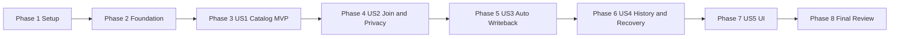

# Tasks: 課堂搶答流程與歷史管理優化

**Input**: `specs/002-optimize-classroom-workflow/` 的 spec.md、plan.md、research.md、data-model.md、contracts/interfaces.md、quickstart.md 與六份 PlantUML。

**Prerequisites**: 上述規劃文件齊備；憲章 1.0.0。使用者指定 TypeScript、Socket.IO、SQLite；實作已啟動，執行狀態依下方核取項目與review-notes.md為準。

**Tests**: 規格與憲章明確要求每項功能正常及特殊情境測試，故納入 unit／integration／contract／e2e／真實驗收；故事測試先寫並確認因缺少功能失敗，再完成實作。

**Organization**: Phase 1 Setup、Phase 2 Foundational、Phase 3–7各一使用者故事（US1–US4 P1、US5 P2），Phase 8最終整合。此為plan粗分階段的可執行拆分，以本文件Phase編號對應新分支。

## Format and Path Conventions

任務格式 `- [ ] Tnnn [P?] [USn?] 描述與明確檔案路徑`；[P]僅同Phase指定前置完成後、不同檔案可並行的工作；故事Phase每項都標US。相對原始碼路徑以儲存庫根目錄為準，文件連結以本目錄為準。

欄位限制的canonical來源為 [data-model.md](data-model.md#entities-and-relationships)。下列實作任務以精確 `table.field` 逐項引用，不複製或改寫既定限制；同一欄位的多次引用仍指向同一定義。測試不得把預定設計當成既有通過結果。

## Common Phase Gate and Branch Policy

每Phase從當時main建立下列專屬新分支，不重用前Phase分支；檢查既有變更並保留，不reset／強制覆寫。
前一Phase全部任務、受影響測試、程式／文件審查通過並merge main後才進下一Phase；[P]不能跨越此門檻。

每次Gate執行：

```powershell
npm run typecheck
npm run lint
npm run format:check
npm run test:unit
npm run test:integration
npm run test:contract
npm run test:e2e
npm run build
```

所有指令exit0，記錄指令／exit code／實際數量與限制於review-notes.md；專案預設format:check忽略specs，所以另以Prettier明確檢查本目錄Markdown。
每Phase合併前，該Phase新增或修改的AI文件須依憲章V由維護者以程式／設定／實測結果核對，記錄結論；
沒有人工核對時不得先合併、等最終Phase再補。此門檻適用每個merge任務，即使任務文字只寫「完成審查」。
圖有變動須先更新、審查、checkonly／渲染再繼續相關實作。新增DB測試使用獨立臨時檔與埠；不停止現有正式服務、不讀真實憑證。
T002設計審查及Phase 1–2文件核對已由維護者完成；後續每Phase文件仍依上述門檻核對，機密授權由使用者自行操作。

## Phase 1: Setup — 準備與設計審查

**Branch**: `codex/002-phase-1-setup`

**Goal**: 建立可重現驗證環境、保護DB檔，完成實作前設計審查。

**Independent Test / Checkpoint**: 既有靜態／測試／建置基線通過，六圖可渲染，維護者審查有明確結論。

- [x] T001 從當時 main 建立本Phase指定新分支，記錄基準commit、工作目錄既有變更與分支至 specs/002-optimize-classroom-workflow/review-notes.md；保留未提交的本版規劃產物，不重設或覆蓋使用者變更
- [x] T002 依憲章 I、V 完成六份 specs/002-optimize-classroom-workflow/diagrams/\*.puml 的語法／渲染與設計對照，提供具體審閱文件並記錄維護者人工設計審查於 specs/002-optimize-classroom-workflow/review-notes.md；未取得結論不得進行功能實作，不沿用第一版審查
- [x] T003 依 research.md R1 固定已驗證Node24 runtime支援範圍，更新 package.json 的engines及必要package-lock.json metadata；確認node:sqlite可用，不引入ORM或多行程服務
- [x] T004 在 .gitignore、.prettierignore 排除 data/、SQLite主檔／WAL／SHM及備份，保留 backend/src/persistence/migrations/ 原始migration；以 git check-ignore 核對新增非機密檔名，結果記 review-notes.md
- [x] T005 在 tests/helpers/temporary-database.ts、tests/helpers/process-harness.ts 建立臨時本機DB目錄／獨立子行程／清理生命週期，並在 tests/fixtures/google-accounts.ts、tests/fixtures/workflow-v2.ts 定義無效合成帳號與多工作表／長組名資料；同步在 playwright.config.ts、tests/helpers/playwright-database.ts 配置每次測試服務啟動專屬的絕對 DATABASE_PATH、啟動前建立與關閉後清理，拒絕指向正式DB；驗證兩次啟動路徑不同且正式DB未讀寫，此為T034接入SQLite前的必要前置；只提供測試支援，不接入正式業務
- [x] T006 依 specs/002-optimize-classroom-workflow/quickstart.md 執行共用Phase Gate全部指令及現有66項測試基線，將實際指令、數量、exit code及六圖結果記入 specs/002-optimize-classroom-workflow/review-notes.md；不把舊測試當新版驗收
- [x] T007 完成本Phase程式／文件審查後commit並merge main，將合併commit與通過證據記至 specs/002-optimize-classroom-workflow/review-notes.md；通過後才允許Phase 2

## Phase 2: Foundational — SQLite與可靠命令基礎

**Branch**: `codex/002-phase-2-foundation`

**Goal**: 建立所有故事共用的持久化、交易、匿名身分及安全錯誤基礎；尚不啟用未完成的新教師流程。

**Independent Test / Checkpoint**: 實檔transaction／唯一性／rollback／receipt去重及Cookie digest恢復通過，無成功ack先於commit。

- [x] T008 確認前Phase已通過並merge main後建立本Phase指定新分支，基準記至 specs/002-optimize-classroom-workflow/review-notes.md
- [x] T009 [P] 先在 tests/unit/sqlite-connection.test.ts 編寫正常開檔、PRAGMA讀回、migration版本／checksum、壞檔／唯讀／busy／設定無效測試，確認新增案例因缺少功能而失敗
- [x] T010 [P] 先在 tests/integration/durable-commands.test.ts 編寫實體DB提交、rollback、commit後ack遺失、相同requestId不同payload、組別／答案唯一鍵及全域slot測試，確認新增案例因缺少功能而失敗
- [x] T011 [P] 先在 tests/unit/persistent-participant.test.ts 編寫同Cookie查回participant、不同Cookie不可接管、Cookie原值不入DB、teacher session及CSRF不持久化的測試，確認新增案例因缺少功能而失敗
- [x] T012 在 backend/src/persistence/connection.ts、backend/src/persistence/migrate.ts、backend/src/persistence/migrations/001-core.ts 實作本機SQLite連線、PRAGMA確認、版本化migration、啟動檢查及關閉checkpoint；DATABASE_PATH接 backend/src/config.ts，故障不可fallback空DB；欄位限制依 [data-model.md](data-model.md#entities-and-relationships)：`schema_migrations.version`、`schema_migrations.applied_at`、`schema_migrations.checksum`
- [x] T013 在 backend/src/persistence/migrations/001-core.ts 建立owner與白名單settings結構，並在 backend/src/persistence/account-repository.ts 提供交易內存取；欄位限制依 [data-model.md](data-model.md#entities-and-relationships)：`teacher_accounts.account_id`、`teacher_accounts.display_email`、`teacher_accounts.display_name`、`teacher_accounts.created_at`、`teacher_settings.account_id`、`teacher_settings.settings_json`、`teacher_settings.updated_at`
- [x] T014 在 backend/src/persistence/migrations/001-core.ts、backend/src/persistence/activity-repository.ts 建立完整活動／來源快照／題目項目及全域slot約束，避免單一Map取代DB；本階段用合成fixture測存取；欄位限制依 [data-model.md](data-model.md#entities-and-relationships)：`activities.id`、`activities.owner_account_id`、`activities.phase`、`activities.created_at`、`activities.started_at`、`activities.ended_at`、`activities.revision`、`activities.next_sequence`、`activities.group_count`、`activities.spreadsheet_id`、`activities.spreadsheet_title`、`activities.source_sheet_id`、`activities.source_sheet_title`、`activities.source_snapshot_json`、`activities.source_fingerprint`、`activities.source_confirmed_at`、`runtime_state.slot`、`runtime_state.current_activity_id`、`questions.activity_id`、`questions.question_id`、`questions.display_number`、`questions.kind`、`questions.ordinal`、`question_items.activity_id`、`question_items.question_id`、`question_items.item_id`、`question_items.ordinal`、`question_items.label`、`question_items.prompt`、`question_items.sheet_id`、`question_items.row_index`、`question_items.column_index`、`question_items.baseline_json`、`question_items.merge_json`
- [x] T015 在 backend/src/persistence/migrations/001-core.ts、backend/src/persistence/participation-repository.ts 建立participant、原子組別綁定、有效提交與完整答案表的複合FK／唯一性保護；組名與答案驗證引用canonical定義；欄位限制依 [data-model.md](data-model.md#entities-and-relationships)：`participants.id`、`participants.browser_token_digest`、`participants.created_at`、`activity_groups.activity_id`、`activity_groups.id`、`activity_groups.ordinal`、`activity_groups.participant_id`、`activity_groups.name`、`activity_groups.joined_at`、`submissions.activity_id`、`submissions.id`、`submissions.group_id`、`submissions.question_id`、`submissions.request_id`、`submissions.received_at`、`submissions.sequence`、`submission_answers.activity_id`、`submission_answers.submission_id`、`submission_answers.question_id`、`submission_answers.item_id`、`submission_answers.answer`
- [x] T016 在 backend/src/persistence/migrations/001-core.ts、backend/src/persistence/receipt-repository.ts 建立活動級／帳號級命令收據，明確白名單序列化安全outcome，不存headers／session／tokens；欄位限制依 [data-model.md](data-model.md#entities-and-relationships)：`command_receipts.activity_id`、`command_receipts.actor_key`、`command_receipts.event`、`command_receipts.request_id`、`command_receipts.payload_fingerprint`、`command_receipts.outcome_json`、`command_receipts.created_at`、`account_command_receipts.owner_account_id`、`account_command_receipts.event`、`account_command_receipts.request_id`、`account_command_receipts.payload_fingerprint`、`account_command_receipts.outcome_json`、`account_command_receipts.created_at`
- [x] T017 在 backend/src/persistence/migrations/001-core.ts、backend/src/persistence/writeback-repository.ts 建立唯一job、逐題狀態及attempt記錄，schema可持久保存但本Phase不派發外部寫入；欄位限制依 [data-model.md](data-model.md#entities-and-relationships)：`results.activity_id`、`results.question_id`、`results.winner_submission_id`、`writeback_jobs.id`、`writeback_jobs.activity_id`、`writeback_jobs.owner_account_id`、`writeback_jobs.status`、`writeback_jobs.reason_code`、`writeback_jobs.created_at`、`writeback_jobs.updated_at`、`writeback_question_states.job_id`、`writeback_question_states.activity_id`、`writeback_question_states.question_id`、`writeback_question_states.status`、`writeback_question_states.expected_answers_json`、`writeback_question_states.target_snapshot_json`、`writeback_question_states.safe_error_code`、`writeback_question_states.updated_at`、`writeback_attempts.id`、`writeback_attempts.job_id`、`writeback_attempts.question_id`、`writeback_attempts.ordinal`、`writeback_attempts.kind`、`writeback_attempts.started_at`、`writeback_attempts.finished_at`、`writeback_attempts.outcome`、`writeback_attempts.safe_error_code`、`writeback_question_states.retry_cycle`、`writeback_question_states.write_attempt_count`、`writeback_question_states.verification_failure_count`、`writeback_question_states.next_attempt_at`、`writeback_attempts.retry_cycle`
- [x] T018 在 backend/src/persistence/unit-of-work.ts、backend/src/activity/command-service.ts 實作同步序列化入口、BEGIN IMMEDIATE、收據查核及commit後發布介面；失敗rollback不可留下可見Map mutation，commit結果未知先查收據，Google網路不得進交易
- [x] T019 在 backend/src/security/sessions.ts、backend/src/security/participants.ts 實作持久匿名Cookie與digest恢復，student穩定actor和teacher短暫session分離；先由依賴注入測試，正式listener接入留US1／US4整合；欄位限制依 [data-model.md](data-model.md#entities-and-relationships)：`participants.id`、`participants.browser_token_digest`、`participants.created_at`
- [x] T020 在 shared/src/schemas/common.ts、backend/src/security/safe-errors.ts、backend/src/security/logger.ts 加入契約新增安全錯誤與儲存故障轉譯；以allowlist輸出，不含SQL／路徑／答案／機密
- [x] T021 在 tests/helpers/classroom-server.ts、tests/helpers/source-server.ts、tests/helpers/writeback.ts 接入隔離repository／transaction及原Google double，讓既有測試與新DB測試共存，不讀正式DB或真實Google授權
- [x] T022 執行共用Phase Gate，新增實檔／digest／rollback／去重測試全通過，並在 specs/002-optimize-classroom-workflow/review-notes.md 記結果；基礎API先以測試fixture獨立驗證，production流程在故事階段完整切換
- [x] T023 完成審查後commit並merge main，將合併commit及證據記至 specs/002-optimize-classroom-workflow/review-notes.md，再進入US1

## Phase 3: User Story 1 — 從Google清單選首張建場 (P1, MVP)

**Branch**: `codex/002-phase-3-catalog`

**Goal**: 授權帳號、瀏覽／搜尋來源、首張預覽與原子建場，不需貼URL／ID。

**Independent Test / Checkpoint**: 兩份不同配置教材可由清單選取並建waiting活動；唯讀、無題首張、不完整清單、過期預覽、帳號切換及同時建場皆明確處理。

- [x] T024 [US1] 確認基礎Phase已merge main後建立本Phase指定分支，記至 specs/002-optimize-classroom-workflow/review-notes.md
- [x] T025 [P] [US1] 先在 tests/contract/google-catalog-http.test.ts 編寫OAuth/status/disconnect、list／preview／create契約、輸入邊界、額外欄位、未授權及跨owner拒絕測試，確認新增案例先失敗
- [x] T026 [P] [US1] 先在 tests/integration/google-catalog.test.ts 編寫多頁／空頁有next／incompleteSearch、同名／共用磁碟、401/403/404/429/5xx、唯讀權限改變、切帳號晚到回覆及create去重測試，確認新增案例先失敗
- [x] T027 [P] [US1] 先在 tests/unit/first-sheet.test.ts 編寫index=0、hidden首張、非GRID首張、零題不fallback、題組辨識、重排／改名後byId固定來源測試，確認新增案例先失敗
- [x] T028 [US1] 在 backend/src/google/oauth.ts、backend/src/google/sheets-client.ts 實作OIDC scopes、state／nonce／ID token驗證、sub與帳號代次；tokens僅記憶體，將公開帳號資料upsert repository；欄位限制依 [data-model.md](data-model.md#entities-and-relationships)：`teacher_accounts.account_id`、`teacher_accounts.display_email`、`teacher_accounts.display_name`、`teacher_accounts.created_at`
- [x] T029 [US1] 在 backend/src/security/guards.ts、backend/src/http/google-routes.ts 實作verified-account與activity-owner guard、status/connect/callback/disconnect，no-store與切帳號舊訂閱／憑證失效；非所屬與不存在同錯誤，不洩漏全域busy活動資料；欄位限制依 [data-model.md](data-model.md#entities-and-relationships)：`activities.id`、`activities.owner_account_id`、`activities.phase`、`activities.created_at`、`activities.started_at`、`activities.ended_at`、`activities.revision`、`activities.next_sequence`、`activities.group_count`、`activities.spreadsheet_id`、`activities.spreadsheet_title`、`activities.source_sheet_id`、`activities.source_sheet_title`、`activities.source_snapshot_json`、`activities.source_fingerprint`、`activities.source_confirmed_at`
- [x] T030 [US1] 在 backend/src/google/drive-client.ts 實作files.list／files.get、query跳脫、canEdit、最小辨識資訊、shared drive與incompleteSearch，cursor綁帳號代次／query／到期；範圍依 contracts/interfaces.md HTTP 限制
- [x] T031 [US1] 在 backend/src/google/sheets-client.ts 拆分readFirstSheet與readSheetById，只讀index=0格值及merges；保留動態parser與讀取退避；首張不支援／無題不可改讀其他表；欄位限制依 [data-model.md](data-model.md#entities-and-relationships)：`activities.id`、`activities.owner_account_id`、`activities.phase`、`activities.created_at`、`activities.started_at`、`activities.ended_at`、`activities.revision`、`activities.next_sequence`、`activities.group_count`、`activities.spreadsheet_id`、`activities.spreadsheet_title`、`activities.source_sheet_id`、`activities.source_sheet_title`、`activities.source_snapshot_json`、`activities.source_fingerprint`、`activities.source_confirmed_at`、`question_items.activity_id`、`question_items.question_id`、`question_items.item_id`、`question_items.ordinal`、`question_items.label`、`question_items.prompt`、`question_items.sheet_id`、`question_items.row_index`、`question_items.column_index`、`question_items.baseline_json`、`question_items.merge_json`
- [x] T032 [US1] 在 backend/src/activity/source-service.ts、backend/src/http/source-routes.ts 實作owner／generation／expiry綁定preview、teacher完整mapping，建立前重驗首張／canEdit／fingerprint；移除繞過檢查的舊貼入來源入口；欄位限制依 [data-model.md](data-model.md#entities-and-relationships)：`activities.id`、`activities.owner_account_id`、`activities.phase`、`activities.created_at`、`activities.started_at`、`activities.ended_at`、`activities.revision`、`activities.next_sequence`、`activities.group_count`、`activities.spreadsheet_id`、`activities.spreadsheet_title`、`activities.source_sheet_id`、`activities.source_sheet_title`、`activities.source_snapshot_json`、`activities.source_fingerprint`、`activities.source_confirmed_at`、`questions.activity_id`、`questions.question_id`、`questions.display_number`、`questions.kind`、`questions.ordinal`、`question_items.activity_id`、`question_items.question_id`、`question_items.item_id`、`question_items.ordinal`、`question_items.label`、`question_items.prompt`、`question_items.sheet_id`、`question_items.row_index`、`question_items.column_index`、`question_items.baseline_json`、`question_items.merge_json`
- [x] T033 [US1] 在 backend/src/activity/create-activity.ts、backend/src/http/activity-routes.ts 實作create交易及帳號級收據，原子保存教材／空組／slot，同request回原活動，來源變化不插半場；欄位限制依 [data-model.md](data-model.md#entities-and-relationships)：`activities.id`、`activities.owner_account_id`、`activities.phase`、`activities.created_at`、`activities.started_at`、`activities.ended_at`、`activities.revision`、`activities.next_sequence`、`activities.group_count`、`activities.spreadsheet_id`、`activities.spreadsheet_title`、`activities.source_sheet_id`、`activities.source_sheet_title`、`activities.source_snapshot_json`、`activities.source_fingerprint`、`activities.source_confirmed_at`、`runtime_state.slot`、`runtime_state.current_activity_id`、`account_command_receipts.owner_account_id`、`account_command_receipts.event`、`account_command_receipts.request_id`、`account_command_receipts.payload_fingerprint`、`account_command_receipts.outcome_json`、`account_command_receipts.created_at`、`activity_groups.activity_id`、`activity_groups.id`、`activity_groups.ordinal`、`activity_groups.participant_id`、`activity_groups.name`、`activity_groups.joined_at`
- [x] T034 [US1] 在 backend/src/main.ts、backend/src/source-module.ts、backend/src/server.ts 將已驗證SQLite初始化、repository及owner-aware來源服務接入正式listener，初始化失敗不listen；取代建立空活動後載入來源的正式流程
- [x] T035 [US1] 在 shared/src/schemas/account.ts、shared/src/schemas/catalog.ts、shared/src/schemas/source.ts 定義strict帳號／清單／cursor／preview／create輸入輸出，限制依 contracts/interfaces.md；groupCount及來源快照約束引用模型；欄位限制依 [data-model.md](data-model.md#entities-and-relationships)：`activities.id`、`activities.owner_account_id`、`activities.phase`、`activities.created_at`、`activities.started_at`、`activities.ended_at`、`activities.revision`、`activities.next_sequence`、`activities.group_count`、`activities.spreadsheet_id`、`activities.spreadsheet_title`、`activities.source_sheet_id`、`activities.source_sheet_title`、`activities.source_snapshot_json`、`activities.source_fingerprint`、`activities.source_confirmed_at`
- [x] T036 [US1] 在 frontend/src/teacher/SourcePage.tsx、frontend/src/transport/http.ts 實作基本授權／搜尋／分頁／首張預覽／設定組數建場及明確錯誤文案，不做全站UI美化
- [x] T037 [US1] 在 backend/src/sockets/activity-handlers.ts、backend/src/http/session-routes.ts、frontend/src/App.tsx 落實teacher owner檢查、currentActivityId過濾、每次推播重驗及generation切換清舊畫面；學生不可藉teacher session bootstrap取得其他活動
- [x] T038 [US1] 在 tests/e2e/catalog-activity.spec.ts、tests/integration/owner-isolation.test.ts 驗證可選表建場及owner隔離；在同Phase移轉 tests/contract/source-http.test.ts、tests/e2e/source-preview.spec.ts、tests/helpers/activity.ts、tests/helpers/source-server.ts 及受新create契約影響的 tests/contract/writeback-http.test.ts、tests/integration/secret-exposure.test.ts 至合成OIDC帳號→清單→首張preview→requestId建場流程；保留原驗證／權限／網路／機密案例，拒絕舊繞過入口；T039前逐一檢查舊create／source呼叫並更新，不能刪除安全案例或延至後Phase；mock授權不冒充真實Google
- [x] T039 [US1] 執行共用Phase Gate與本故事正常／特殊測試，將來源契約、六圖對照與結果同步 specs/002-optimize-classroom-workflow/quickstart.md、specs/002-optimize-classroom-workflow/review-notes.md；只以合成Google完成本Phase獨立驗收
- [x] T040 [US1] 完成審查後commit並merge main，記錄於 specs/002-optimize-classroom-workflow/review-notes.md，再進入US2

## Phase 4: User Story 2 — 必填鎖名加入與開放後顯題 (P1)

**Branch**: `codex/002-phase-4-students`

**Goal**: 一次加入即鎖定名稱、等待零題目洩漏、共同首答及即時教師完整組名。

**Independent Test / Checkpoint**: 兩學生身分完整流程、無效命名不占組、同搶組一成功、waiting封包零題、active無他組進度、題組首答與2秒同步。

- [x] T041 [US2] 確認US1已merge main後建立本Phase指定分支，記至 specs/002-optimize-classroom-workflow/review-notes.md
- [x] T042 [P] [US2] 先在 tests/contract/student-projections.test.ts 編寫waiting HTTP/socket/reconnect無題號／prompt／item／source、active無他組進度、所有rename拒絕與join嚴格輸入契約，確認新增案例先失敗
- [x] T043 [P] [US2] 先在 tests/integration/atomic-group-answer.test.ts 編寫空白／邊界／特殊字組名、同搶組、完整題組、重送／ack遺失／同時送答／時鐘回撥／end交錯測試，確認新增案例先失敗
- [x] T044 [US2] 在 shared/src/schemas/activity.ts、shared/src/formatters/group-name.ts 定義join的必填名稱與完整名稱formatter，限制依模型；拒絕rename，前後端共用驗證；欄位限制依 [data-model.md](data-model.md#entities-and-relationships)：`activity_groups.activity_id`、`activity_groups.id`、`activity_groups.ordinal`、`activity_groups.participant_id`、`activity_groups.name`、`activity_groups.joined_at`、`submission_answers.activity_id`、`submission_answers.submission_id`、`submission_answers.question_id`、`submission_answers.item_id`、`submission_answers.answer`
- [x] T045 [US2] 在 backend/src/activity/group-reducer.ts、backend/src/activity/command-service.ts 接入join交易，綁組＋名稱＋收據同commit，舊group:rename回NAME_LOCKED；同身分重連不得變名；欄位限制依 [data-model.md](data-model.md#entities-and-relationships)：`activity_groups.activity_id`、`activity_groups.id`、`activity_groups.ordinal`、`activity_groups.participant_id`、`activity_groups.name`、`activity_groups.joined_at`、`participants.id`、`participants.browser_token_digest`、`participants.created_at`、`command_receipts.activity_id`、`command_receipts.actor_key`、`command_receipts.event`、`command_receipts.request_id`、`command_receipts.payload_fingerprint`、`command_receipts.outcome_json`、`command_receipts.created_at`
- [x] T046 [US2] 在 backend/src/activity/submission-reducer.ts、backend/src/activity/lifecycle-reducer.ts 接入active檢查、完整答案交易、next_sequence與首答，start持久化；不在記憶體先回成功；欄位限制依 [data-model.md](data-model.md#entities-and-relationships)：`submissions.activity_id`、`submissions.id`、`submissions.group_id`、`submissions.question_id`、`submissions.request_id`、`submissions.received_at`、`submissions.sequence`、`submission_answers.activity_id`、`submission_answers.submission_id`、`submission_answers.question_id`、`submission_answers.item_id`、`submission_answers.answer`、`activities.id`、`activities.owner_account_id`、`activities.phase`、`activities.created_at`、`activities.started_at`、`activities.ended_at`、`activities.revision`、`activities.next_sequence`、`activities.group_count`、`activities.spreadsheet_id`、`activities.spreadsheet_title`、`activities.source_sheet_id`、`activities.source_sheet_title`、`activities.source_snapshot_json`、`activities.source_fingerprint`、`activities.source_confirmed_at`、`command_receipts.activity_id`、`command_receipts.actor_key`、`command_receipts.event`、`command_receipts.request_id`、`command_receipts.payload_fingerprint`、`command_receipts.outcome_json`、`command_receipts.created_at`
- [x] T047 [US2] 在 shared/src/projections/activity.ts、backend/src/sockets/activity-handlers.ts 實作phase／role白名單投影、commit後publish、self receipt；teacher-only欄位不進student封包，teacher每次emit重驗owner
- [x] T048 [US2] 在 frontend/src/student/GroupPage.tsx、frontend/src/student/AnswerPage.tsx 實作一次選組命名、鎖名、等待畫面及active才顯題；拒絕部分題組，成功以server receipt為準
- [x] T049 [US2] 在 frontend/src/teacher/ActivityPage.tsx、frontend/src/components/ResultsView.tsx、frontend/src/teacher/WritebackPanel.tsx 所有既有組別顯示接共用fullName，基本可讀即可，統一表格優化留US5；欄位限制依 [data-model.md](data-model.md#entities-and-relationships)：`activity_groups.activity_id`、`activity_groups.id`、`activity_groups.ordinal`、`activity_groups.participant_id`、`activity_groups.name`、`activity_groups.joined_at`
- [x] T050 [US2] 在 frontend/src/transport/socket.ts 更新重送／pending／revision處理；跨boot重新session及subscribe完整快照，舊socket／舊generation回覆丟棄，移除boot不同必須新活動的訊息
- [x] T051 [US2] 在 tests/e2e/anonymous-join-privacy.spec.ts 驗兩獨立瀏覽器context、同Cookie多分頁、清Cookie不可接管、40字完整名、等待封包隱私及開始／結束同步≤2秒
- [x] T052 [US2] 同步更新 tests/unit/activity-projections.test.ts、tests/integration/activity-ordering.test.ts、tests/contract/activity-sockets.test.ts、tests/e2e/classroom-activity.spec.ts 中被本版取代的預期；其餘原安全／完整題組／首答測試保留
- [x] T053 [US2] 執行共用Phase Gate及本故事正常／特殊測試，更新 specs/002-optimize-classroom-workflow/quickstart.md、specs/002-optimize-classroom-workflow/review-notes.md；完成資料管道隱私核對後才通過
- [x] T054 [US2] 完成審查後commit並merge main，記至 specs/002-optimize-classroom-workflow/review-notes.md，再進入US3

## Phase 5: User Story 3 — 結束自動回填與安全復原 (P1)

**Branch**: `codex/002-phase-5-writeback`

**Goal**: 正常end一次操作即可靠排程回填，關頁不取消工作，未知結果先查核。

**Independent Test / Checkpoint**: 兩組作答後end無第二按鈕原表verified；題組全寫、未答不改，逾時／崩潰／授權不足不誤報。

- [x] T055 [US3] 確認US2已merge main後建立本Phase指定分支，記至 specs/002-optimize-classroom-workflow/review-notes.md
- [x] T056 [P] [US3] 先在 tests/contract/automatic-writeback-http.test.ts 編寫end排job、verify/retry、跨owner、舊手動初次write入口拒絕與安全status契約，確認新增案例先失敗
- [x] T057 [P] [US3] 先在 tests/integration/durable-writeback.test.ts 編寫end/results/job同交易、重複end／開歷史不重寫、零成功組、整題組、原sheetId、非目標／格式及equals字串測試，確認新增案例先失敗
- [x] T058 [P] [US3] 先在 tests/integration/writeback-crash.test.ts 編寫實檔子行程在end commit後worker前／writing後送寫前／送寫後讀回前／讀回後本機保存前中斷，以及未知三路分類／DB保存失敗停止派發測試；以可控制時鐘驗證 data-model.md「Retry Policy」的寫入／查核上限、到期才派發、重啟不重設計數、無授權不耗次數、未知結果暫停不誤報failed及人工retry去重，確認新增案例先失敗
- [x] T059 [US3] 在 backend/src/activity/lifecycle-reducer.ts、backend/src/activity/results.ts 實作end交易固定逐題結果、唯一outbox及逐題expected，無答亦存零項verified工作，重複end不新增job；欄位限制依 [data-model.md](data-model.md#entities-and-relationships)：`results.activity_id`、`results.question_id`、`results.winner_submission_id`、`writeback_jobs.id`、`writeback_jobs.activity_id`、`writeback_jobs.owner_account_id`、`writeback_jobs.status`、`writeback_jobs.reason_code`、`writeback_jobs.created_at`、`writeback_jobs.updated_at`、`writeback_question_states.job_id`、`writeback_question_states.activity_id`、`writeback_question_states.question_id`、`writeback_question_states.status`、`writeback_question_states.expected_answers_json`、`writeback_question_states.target_snapshot_json`、`writeback_question_states.safe_error_code`、`writeback_question_states.updated_at`、`command_receipts.activity_id`、`command_receipts.actor_key`、`command_receipts.event`、`command_receipts.request_id`、`command_receipts.payload_fingerprint`、`command_receipts.outcome_json`、`command_receipts.created_at`
- [x] T060 [US3] 在 backend/src/google/writeback-worker.ts、backend/src/persistence/writeback-repository.ts 實作單行程工作序列化、claim／安全進度／attempt持久化及啟動wake介面，依data-model.md「Retry Policy」保存cycle／計數／next_attempt_at並限制到期派發，Google呼叫在交易外，DB失敗停止派發；欄位限制依 [data-model.md](data-model.md#entities-and-relationships)：`writeback_jobs.id`、`writeback_jobs.activity_id`、`writeback_jobs.owner_account_id`、`writeback_jobs.status`、`writeback_jobs.reason_code`、`writeback_jobs.created_at`、`writeback_jobs.updated_at`、`writeback_question_states.job_id`、`writeback_question_states.activity_id`、`writeback_question_states.question_id`、`writeback_question_states.status`、`writeback_question_states.expected_answers_json`、`writeback_question_states.target_snapshot_json`、`writeback_question_states.safe_error_code`、`writeback_question_states.updated_at`、`writeback_attempts.id`、`writeback_attempts.job_id`、`writeback_attempts.question_id`、`writeback_attempts.ordinal`、`writeback_attempts.kind`、`writeback_attempts.started_at`、`writeback_attempts.finished_at`、`writeback_attempts.outcome`、`writeback_attempts.safe_error_code`、`writeback_question_states.retry_cycle`、`writeback_question_states.write_attempt_count`、`writeback_question_states.verification_failure_count`、`writeback_question_states.next_attempt_at`、`writeback_attempts.retry_cycle`
- [x] T061 [US3] 在 backend/src/google/writeback-service.ts、backend/src/google/sheets-client.ts 依原sheetId預檢題目／merge／baseline，每題組一次batchUpdate stringValue value-only mask；只讀回全expected才verified；欄位限制依 [data-model.md](data-model.md#entities-and-relationships)：`question_items.activity_id`、`question_items.question_id`、`question_items.item_id`、`question_items.ordinal`、`question_items.label`、`question_items.prompt`、`question_items.sheet_id`、`question_items.row_index`、`question_items.column_index`、`question_items.baseline_json`、`question_items.merge_json`、`writeback_question_states.job_id`、`writeback_question_states.activity_id`、`writeback_question_states.question_id`、`writeback_question_states.status`、`writeback_question_states.expected_answers_json`、`writeback_question_states.target_snapshot_json`、`writeback_question_states.safe_error_code`、`writeback_question_states.updated_at`
- [x] T062 [US3] 在 backend/src/google/writeback-worker.ts、backend/src/google/oauth.ts 按job owner取記憶體授權、切帳號不代寫；writing崩潰變pending先查核，全baseline才可安全重試，conflict不盲寫，無原授權保留等待；依data-model.md「Retry Policy」執行固定預算與退避，restart不歸零、未知滿限保持pending、owner明確retry與收據同交易開新cycle；欄位限制依 [data-model.md](data-model.md#entities-and-relationships)：`writeback_jobs.id`、`writeback_jobs.activity_id`、`writeback_jobs.owner_account_id`、`writeback_jobs.status`、`writeback_jobs.reason_code`、`writeback_jobs.created_at`、`writeback_jobs.updated_at`、`writeback_question_states.job_id`、`writeback_question_states.activity_id`、`writeback_question_states.question_id`、`writeback_question_states.status`、`writeback_question_states.expected_answers_json`、`writeback_question_states.target_snapshot_json`、`writeback_question_states.safe_error_code`、`writeback_question_states.updated_at`、`writeback_attempts.id`、`writeback_attempts.job_id`、`writeback_attempts.question_id`、`writeback_attempts.ordinal`、`writeback_attempts.kind`、`writeback_attempts.started_at`、`writeback_attempts.finished_at`、`writeback_attempts.outcome`、`writeback_attempts.safe_error_code`、`writeback_question_states.retry_cycle`、`writeback_question_states.write_attempt_count`、`writeback_question_states.verification_failure_count`、`writeback_question_states.next_attempt_at`、`writeback_attempts.retry_cycle`
- [x] T063 [US3] 在 backend/src/http/writeback-routes.ts、backend/src/source-module.ts 接上verify／retry既有job及owner驗證；移除手動初次派發入口，同request去重、verified不重寫、pending先verify；欄位限制依 [data-model.md](data-model.md#entities-and-relationships)：`command_receipts.activity_id`、`command_receipts.actor_key`、`command_receipts.event`、`command_receipts.request_id`、`command_receipts.payload_fingerprint`、`command_receipts.outcome_json`、`command_receipts.created_at`、`writeback_jobs.id`、`writeback_jobs.activity_id`、`writeback_jobs.owner_account_id`、`writeback_jobs.status`、`writeback_jobs.reason_code`、`writeback_jobs.created_at`、`writeback_jobs.updated_at`
- [x] T064 [US3] 在 shared/src/schemas/writeback.ts、backend/src/sockets/activity-handlers.ts 發布安全整體／逐題status和reason，查核仍pending不報成功，不向student送工作資料；欄位限制依 [data-model.md](data-model.md#entities-and-relationships)：`writeback_jobs.id`、`writeback_jobs.activity_id`、`writeback_jobs.owner_account_id`、`writeback_jobs.status`、`writeback_jobs.reason_code`、`writeback_jobs.created_at`、`writeback_jobs.updated_at`、`writeback_question_states.job_id`、`writeback_question_states.activity_id`、`writeback_question_states.question_id`、`writeback_question_states.status`、`writeback_question_states.expected_answers_json`、`writeback_question_states.target_snapshot_json`、`writeback_question_states.safe_error_code`、`writeback_question_states.updated_at`
- [x] T065 [US3] 在 frontend/src/teacher/ActivityPage.tsx、frontend/src/teacher/WritebackPanel.tsx 明示結束即自動回填／暫停外部編輯，移除正常初次回填按鈕，只在例外提供授權／查核／安全重試
- [x] T066 [US3] 在 tests/e2e/automatic-writeback.spec.ts 驗end後關老師頁、worker仍完成、重開只看狀態；更新 tests/integration/writeback.test.ts、tests/contract/writeback-http.test.ts、tests/e2e/results-writeback.spec.ts 被取代的手動初次回填預期
- [x] T067 [US3] 執行共用Phase Gate及回填正常／特殊／crash案例，將限制與結果同步 specs/002-optimize-classroom-workflow/quickstart.md、specs/002-optimize-classroom-workflow/review-notes.md；Google double不冒充真實原表驗收
- [x] T068 [US3] 完成審查後commit並merge main，記至 specs/002-optimize-classroom-workflow/review-notes.md，再進入US4

## Phase 6: User Story 4 — 持久歷史、設定與自動恢復 (P1)

**Branch**: `codex/002-phase-6-history`

**Goal**: 老師重開可查自己帳號完整歷史，active重啟自動續答，完成核心真實驗收。

**Independent Test / Checkpoint**: 至少三場（兩ended、一active）跨頁面／瀏覽器／行程重啟100%一致；兩帳號隔離，原兩學生不需教師動作可續答。

- [ ] T069 [US4] 確認US3已merge main後建立本Phase指定分支，記至 specs/002-optimize-classroom-workflow/review-notes.md
- [ ] T070 [P] [US4] 先在 tests/contract/history-settings-http.test.ts 編寫歷史list/detail cursor、settings讀寫去重、未授權／跨帳號／額外欄位契約，確認新增案例先失敗
- [ ] T071 [P] [US4] 先在 tests/integration/activity-restart.test.ts 編寫三場實檔／子行程重啟、active自動恢復、原Cookie／原URL／sequence／receipt、waiting與ended原phase、故障不空DB測試，確認新增案例先失敗
- [ ] T072 [P] [US4] 先在 tests/integration/history-isolation.test.ts 編寫兩帳號同來源但各自歷史／設定、切換清資料、直接ID／舊socket拒絕、原帳號授權後來源刪除仍讀快照，確認新增案例先失敗
- [ ] T073 [US4] 在 backend/src/activity/history-service.ts、backend/src/http/history-routes.ts 實作owner限定created_at/id游標分頁、歷史詳情及回填摘要；資料來自DB，不要求重新讀Google；欄位限制依 [data-model.md](data-model.md#entities-and-relationships)：`activities.id`、`activities.owner_account_id`、`activities.phase`、`activities.created_at`、`activities.started_at`、`activities.ended_at`、`activities.revision`、`activities.next_sequence`、`activities.group_count`、`activities.spreadsheet_id`、`activities.spreadsheet_title`、`activities.source_sheet_id`、`activities.source_sheet_title`、`activities.source_snapshot_json`、`activities.source_fingerprint`、`activities.source_confirmed_at`、`results.activity_id`、`results.question_id`、`results.winner_submission_id`、`writeback_jobs.id`、`writeback_jobs.activity_id`、`writeback_jobs.owner_account_id`、`writeback_jobs.status`、`writeback_jobs.reason_code`、`writeback_jobs.created_at`、`writeback_jobs.updated_at`
- [ ] T074 [US4] 在 backend/src/http/settings-routes.ts、shared/src/schemas/settings.ts 實作defaultGroupCount白名單設定、commit後確認與帳號級收據；限制引用teacher_settings及activities.group_count；欄位限制依 [data-model.md](data-model.md#entities-and-relationships)：`teacher_settings.account_id`、`teacher_settings.settings_json`、`teacher_settings.updated_at`、`account_command_receipts.owner_account_id`、`account_command_receipts.event`、`account_command_receipts.request_id`、`account_command_receipts.payload_fingerprint`、`account_command_receipts.outcome_json`、`account_command_receipts.created_at`、`activities.id`、`activities.owner_account_id`、`activities.phase`、`activities.created_at`、`activities.started_at`、`activities.ended_at`、`activities.revision`、`activities.next_sequence`、`activities.group_count`、`activities.spreadsheet_id`、`activities.spreadsheet_title`、`activities.source_sheet_id`、`activities.source_sheet_title`、`activities.source_snapshot_json`、`activities.source_fingerprint`、`activities.source_confirmed_at`
- [ ] T075 [US4] 在 backend/src/main.ts、backend/src/activity/store.ts、backend/src/http/session-routes.ts 完成多場歷史與全域slot復原；載入失敗不listen、不重建空DB；bootId僅診斷，active不改phase、不end或自動寫回，學生續答不等待OAuth；欄位限制依 [data-model.md](data-model.md#entities-and-relationships)：`activities.id`、`activities.owner_account_id`、`activities.phase`、`activities.created_at`、`activities.started_at`、`activities.ended_at`、`activities.revision`、`activities.next_sequence`、`activities.group_count`、`activities.spreadsheet_id`、`activities.spreadsheet_title`、`activities.source_sheet_id`、`activities.source_sheet_title`、`activities.source_snapshot_json`、`activities.source_fingerprint`、`activities.source_confirmed_at`、`runtime_state.slot`、`runtime_state.current_activity_id`
- [ ] T076 [US4] 在 backend/src/security/sessions.ts、backend/src/google/writeback-worker.ts 接通重新啟動的student digest恢復及pending工作查核，原帳號重新授權喚醒原job，teacher新session先授權才查歷史；欄位限制依 [data-model.md](data-model.md#entities-and-relationships)：`participants.id`、`participants.browser_token_digest`、`participants.created_at`、`writeback_jobs.id`、`writeback_jobs.activity_id`、`writeback_jobs.owner_account_id`、`writeback_jobs.status`、`writeback_jobs.reason_code`、`writeback_jobs.created_at`、`writeback_jobs.updated_at`、`writeback_question_states.job_id`、`writeback_question_states.activity_id`、`writeback_question_states.question_id`、`writeback_question_states.status`、`writeback_question_states.expected_answers_json`、`writeback_question_states.target_snapshot_json`、`writeback_question_states.safe_error_code`、`writeback_question_states.updated_at`
- [ ] T077 [US4] 在 frontend/src/teacher/HistoryPage.tsx、frontend/src/teacher/HistoryDetailPage.tsx、frontend/src/teacher/SettingsPage.tsx、frontend/src/App.tsx 提供基本歷史與設定導航；切帳號清快取、顯完整組名／結果／工作，不進行整體美化
- [ ] T078 [US4] 在 tests/e2e/history-recovery.spec.ts 驗老師關頁／重開／重授權、history無重複回填、設定保存、兩帳號切換無舊資料閃現；沿用T005已完成的 playwright.config.ts 臨時DB隔離，同一重啟情境保留同一臨時DB、不同案例使用不同檔案，情境結束才清理，不在本Phase才首次配置隔離
- [ ] T079 [US4] 在 tests/manual/workflow-v2-restart.mjs 更新新版capture/verify流程，僅保存非機密ID與計數、不匯出Cookie；實際停止／重啟Node後用原Chrome／Edge資料確認原場續答，保留第一版manual腳本作歷史證據
- [ ] T080 [US4] 依 specs/002-optimize-classroom-workflow/quickstart.md 完成兩份真實Google清單選表→兩瀏覽器命名→開放→作答→end自動回填，另驗首張及重排；將Google讀回、目標／非目標與格式核對證據安全記入 specs/002-optimize-classroom-workflow/review-notes.md
- [ ] T081 [US4] 依 specs/002-optimize-classroom-workflow/quickstart.md 完成兩個真實Google帳號歷史隔離、至少三場資料比對、實際服務重啟原學生自動續答及重新授權後查歷史；由使用者完成OAuth，不記機密，結果記 specs/002-optimize-classroom-workflow/review-notes.md
- [ ] T082 [US4] 執行共用Phase Gate，逐項核對US1–4與SC-001–SC-008、SC-010核心、SC-011並同步 specs/002-optimize-classroom-workflow/quickstart.md、specs/002-optimize-classroom-workflow/review-notes.md；真實或人審未完成不得勾通過
- [ ] T083 [US4] 完成審查後commit並merge main，記至 specs/002-optimize-classroom-workflow/review-notes.md；核心驗收全部通過才允許US5統一UI優化

## Phase 7: User Story 5 — 核心驗收後統一UI (P2)

**Branch**: `codex/002-phase-7-ui`

**Goal**: 統一老師／學生文案與版面，教師用完整組名表格比較各組逐題狀況。

**Independent Test / Checkpoint**: 四組六題40字組名在1280×720可讀，長表可捲，文字狀態與鍵盤可用；重跑全部核心流程無回歸。

- [ ] T084 [US5] 確認US1–4全部驗收且US4已merge main，才建立本Phase指定分支，記至 specs/002-optimize-classroom-workflow/review-notes.md
- [ ] T085 [P] [US5] 先在 tests/e2e/teacher-progress-table.spec.ts 編寫四組六題40字／特殊字名、占用／受理／成功組、完整文字可讀與長表捲動測試，確認新增案例先失敗
- [ ] T086 [P] [US5] 先在 tests/e2e/workflow-usability.spec.ts 編寫空／loading／未授權／等待／pending／failed／conflict／verified文字、不可用操作原因與鍵盤操作測試，確認新增案例先失敗
- [ ] T087 [US5] 在 frontend/src/teacher/ProgressTable.tsx、frontend/src/teacher/ActivityPage.tsx 以語意table顯示組別為列、題目為欄、完整名／占用／逐題提交／成功組；使用既有teacher projection，不新增學生可見欄位
- [ ] T088 [US5] 在 frontend/src/teacher/HistoryPage.tsx、frontend/src/teacher/HistoryDetailPage.tsx、frontend/src/teacher/SourcePage.tsx 統一清單／搜尋／歷史／返回活動／來源首張標示及錯誤復原，保留完整組名與來源辨識
- [ ] T089 [US5] 在 frontend/src/components/OperationStatus.tsx、frontend/src/components/ConnectionStatus.tsx、frontend/src/teacher/WritebackPanel.tsx 統一可理解文字及有效操作，區分已保存／已結束／回填中／已確認，不能只用顏色
- [ ] T090 [US5] 在 frontend/src/student/GroupPage.tsx、frontend/src/student/AnswerPage.tsx、frontend/src/student/ResultsPage.tsx、frontend/src/styles.css 統一加入／鎖名／等待／作答／結果版面；長名換行與表格捲動，不改角色資料權限
- [ ] T091 [US5] 在 tests/e2e/teacher-progress-table.spec.ts、tests/e2e/workflow-usability.spec.ts 完成可見UI與鍵盤人工核對並記錄於 specs/002-optimize-classroom-workflow/review-notes.md；只以合成資料截圖，真實OAuth停用錄製
- [ ] T092 [US5] 執行共用Phase Gate及SC-009／SC-010完整回歸，更新 specs/002-optimize-classroom-workflow/quickstart.md、specs/002-optimize-classroom-workflow/review-notes.md；UI變更不可破壞waiting隱題、owner隔離與自動回填
- [ ] T093 [US5] 完成審查後commit並merge main，記至 specs/002-optimize-classroom-workflow/review-notes.md，再進最終Phase

## Phase 8: Polish and Cross-Cutting — 最終整合審查

**Branch**: `codex/002-phase-8-final`

**Goal**: 完成安全產物、備份恢復、全套測試及新版文件人工核對，交付可重現本機流程。

**Independent Test / Checkpoint**: 所有測試／靜態／建置／六圖通過，人工審查和真實驗收有證據，Git無DB或機密產物。

- [ ] T094 確認US5已merge main後建立本Phase指定新分支，記至 specs/002-optimize-classroom-workflow/review-notes.md
- [ ] T095 [P] 在 tests/integration/persistent-secret-exposure.test.ts 以無效合成敏感值檢查DB／WAL／SHM／備份、response／log／報告，verifyIdToken與OAuth回覆原值不得落盤，且git check-ignore涵蓋所有DB產物
- [ ] T096 [P] 在 tests/integration/sqlite-backup-restore.test.ts 驗已確認活動的安全備份與停止服務後恢復、foreign-key／integrity檢查及損壞拒絕；備份方法依 research.md R2，不於運作中只複製主DB
- [ ] T097 在 specs/002-optimize-classroom-workflow/quickstart.md 補齊實際DATABASE_PATH、支援runtime、DB備份恢復／升級操作及各Phase實測指令結果，核對 contracts/interfaces.md 與實作一致；發現流程變更先更新 diagrams/\*.puml 再改程式
- [ ] T098 執行共用Phase Gate與六圖checkonly／重新渲染，重跑完整新版及未被取代舊案例，將測試數、exit code、2秒同步、長表、真實Google及重啟證據索引記入 specs/002-optimize-classroom-workflow/review-notes.md
- [ ] T099 在 specs/002-optimize-classroom-workflow/review-notes.md 提供對照程式／設定／實測結果的具體新版文件審查包，取得維護者人工核對結論並修正差異；未回覆不記通過，第一版審查不得代替
- [ ] T100 在 specs/002-optimize-classroom-workflow/tasks.md 逐項核對完成證據與FR/SC覆蓋、未填範本／文件連結／欄位引用及DB／機密Git排除；未完成保持未勾，不為收斂而虛報
- [ ] T101 全部門檻通過及審查完成後commit並merge main，在 specs/002-optimize-classroom-workflow/review-notes.md 記最終合併commit與限制；不自動push／部署或修改未授權教材

## Dependencies and Execution Order



US1依賴共用DB／session基礎；US2用US1建立的教材活動；US3用US2的有效提交與正常end；US4整合持久歷史與US3的工作恢復；US5嚴格等US1–4核心驗收通過。基礎階段只建立通用存取與測試支援，不提早實作全站美化。

每故事可用合成來源與已完成前置獨立驗收，不必等待後續故事；US1 MVP只代表清單建場增量，不代表完整新搶答系統已交付。真實Google、兩帳號及服務重啟整體驗收集中US4、US5前完成。

## Parallel Execution Examples

只允許同Phase明確[P]的測試撰寫並行，先完成該Phase分支建立，並以Phase1合成fixtures為共同前置；測試對尚未實作功能的預期失敗需區分基礎環境錯誤。實作順序仍為模型／schema→服務→介面→整合，不同任務共用同檔時一律序列執行。

- **US1**：`T025`、`T026`、`T027` 可並行撰寫，各自不同測試檔；之後按本故事順序實作並通過Checkpoint。
- **US2**：`T042`、`T043` 可並行撰寫，各自不同測試檔；之後按本故事順序實作並通過Checkpoint。
- **US3**：`T056`、`T057`、`T058` 可並行撰寫，各自不同測試檔；之後按本故事順序實作並通過Checkpoint。
- **US4**：`T070`、`T071`、`T072` 可並行撰寫，各自不同測試檔；之後按本故事順序實作並通過Checkpoint。
- **US5**：`T085`、`T086` 可並行撰寫，各自不同測試檔；之後按本故事順序實作並通過Checkpoint。

基礎Phase的SQLite／transaction／participant測試可並行；最終合成機密掃描與備份恢復測試在隔離資料目錄可並行。使用者要求各Phase串行，故不跨故事分支同時開發。

## Implementation Strategy

1. 先完成Setup人工設計審查及共用SQLite基礎，各Phase測試／合併後再繼續。
2. MVP範圍為Phase1–3：US1可從已授權Google清單選表、只讀首張並原子建場，包含其錯誤處理；不宣稱其餘故事已完成。
3. 依序交付US2、US3、US4；每次保留已完成故事的回歸測試。只有US1–4與核心真實驗收通過才做US5。
4. 最終完成新版文件人工核對、全套驗證、安全產物檢查再merge main；不自動push或部署。

## Requirements and Outcome Coverage

| 需求／成功條件                        | 主要故事／共用階段          | 必要驗證                                                         |
| ------------------------------------- | --------------------------- | ---------------------------------------------------------------- |
| FR-001、FR-028、SC-011                | Foundation、US1、US4、Final | role／owner隔離、直接ID、舊socket、未授權無歷史、合成機密        |
| FR-002–FR-007、SC-001、SC-006         | US1                         | 清單分頁與錯誤、首張、唯讀、預覽重驗、原子建場、真實兩份來源     |
| FR-008–FR-016、SC-002–SC-004          | US2                         | 全資料管道隱題、完整名與鎖名、題組、共同序列、2秒、兩瀏覽器      |
| FR-017–FR-022、SC-005、SC-006、SC-008 | US3、US4                    | end與job同交易、無第二按鈕、原表精確寫回、未知先查核、原owner    |
| FR-023–FR-027、SC-007、SC-008         | Foundation、US4             | 實體SQLite、故障點、三場歷史／設定、active自動續答、原身分及順位 |
| FR-029–FR-030、SC-009、SC-010         | US5                         | 四組六題40字名、1280×720表格、鍵盤、文字狀態、核心回歸           |
| FR-031、SC-011                        | 全階段、Final               | 不讀或保存真實機密、DB/WAL/SHM/備份／response／log／Git檢查      |

## Completion Notes

全部任務初始未勾；只有實際完成並取得所需證據才改為[x]。外部授權／人工審查未完成需保持待辦，不能以「繼續」或先前版本證據代替。各Phase最後merge任務完成且其證據可查後，才開始下一Phase。

## Phase 9: Convergence

**Branch**: `codex/002-phase-9-convergence`

**Goal**: 關閉2026-11-25以現況程式核對出的17項缺口；此為剩餘義務追蹤，不改寫原Phase或宣稱前置已通過。

**Independent Test / Checkpoint**: 原Phase 3–8門檻及本節逐項證據齊備，正式HTTP／Socket走持久命令，原兩學生跨服務重啟續答，結束自動回填，owner歷史／設定與UI完整，正常／特殊案例及文件人工核對通過。

**Execution**: 必須先依原順序完成T040–T101；各缺口應在所對應的原Phase修補，不得因追加到Phase 9而延後隱私、驗證、儲存或人工核對門檻。前置完成後才建立本節分支，測試全通過且本節文件人工核對後才合併main。若原任務已消除缺口，本節以實際驗證證據關閉，不再重做建場、回填或其他副作用。不得把本次converge或原有測試通過視為人工核對。

**Assessment**: 31項FR、11項SC、31個US驗收情境、12項計畫決策、6項憲章原則及101個既有任務均納入現況核對；原任務39項已勾、62項未勾，勾選不作為功能證據。17項findings：missing 4、partial 8、contradicts 5、unrequested 0；CRITICAL 7、HIGH 9、MEDIUM 1。未使用Git或分支比較，未修改程式／規格／計畫，未執行真實Google操作。本次7項唯讀probe確認現有缺口，不是新版驗收通過；待辦測試仍須由implement執行。

- [ ] T102 CRITICAL F01：依憲章III補齊正式外部輸入驗證，在 shared/src/schemas/activity.ts、backend/src/activity/group-reducer.ts、backend/src/activity/command-service.ts、frontend/src/student/GroupPage.tsx 完成選組與trim後1–40 UTF-16字名稱一次確認；無效名稱不占組、同身分重送不更名、所有rename拒絕NAME_LOCKED；以 tests/contract/student-projections.test.ts、tests/integration/atomic-group-answer.test.ts 驗正常／空白／40及41字／額外欄位／同搶組，核對原T042–T045、T048 per Constitution III、FR-010–FR-012、US2/AC1–3、US2/AC6 (contradicts)
- [ ] T103 CRITICAL F02：在 shared/src/projections/activity.ts、backend/src/sockets/activity-handlers.ts、frontend/src/student/AnswerPage.tsx 封閉waiting學生題號、題幹、item及來源填空資料；teacher保留完整教材，active／ended依角色提供允許資料；以 tests/contract/student-projections.test.ts、tests/e2e/anonymous-join-privacy.spec.ts 驗初載／直接請求／subscribe／重連及兩學生開放後≤2秒顯題，核對原T042、T047–T048、T051 per FR-008–FR-009、FR-016、SC-002、US2/AC4–5 (contradicts)
- [ ] T104 CRITICAL F03：在 backend/src/sockets/activity-handlers.ts、backend/src/activity/lifecycle-reducer.ts、backend/src/activity/submission-reducer.ts、backend/src/activity/command-service.ts 將正式join／start／submit接上SQLite短交易、穩定actor及持久收據，commit後才更新快照／ack／publish；儲存失敗不得先變更Map或受理順位，重送與end交錯維持首次完整答案；在 tests/integration/atomic-group-answer.test.ts、tests/integration/durable-commands.test.ts 驗正式入口的rollback／ack遺失／sequence／同payload重放，核對原T045–T047 per FR-014–FR-016、FR-023–FR-024、SC-004、plan: transaction command service (contradicts)
- [ ] T105 CRITICAL F04：在 backend/src/activity/lifecycle-reducer.ts、backend/src/activity/results.ts、backend/src/persistence/writeback-repository.ts 將正常end、固定逐題結果及唯一job同交易保存並喚醒自動處理；零成功組亦存零項verified工作，重複end／重開不得再排正常工作；在 frontend/src/teacher/ActivityPage.tsx 明示結束即自動回填及暫停外部編輯，WritebackPanel.tsx與 backend/src/http/writeback-routes.ts 移除正常初次手動派發；以 tests/integration/durable-writeback.test.ts、tests/e2e/automatic-writeback.spec.ts 驗無第二按鈕、關老師頁仍處理，核對原T056–T059、T063、T065–T066 per FR-017–FR-018、FR-021、SC-005、US3/AC1–4 (contradicts)
- [ ] T106 CRITICAL F05：在 backend/src/google/writeback-worker.ts、backend/src/google/oauth.ts、backend/src/persistence/writeback-repository.ts 接通單行程owner工作序列化、持久claim／attempt／cycle／計數／next_attempt_at與啟動喚醒；遵守plan所引data-model Retry Policy，Google在交易外、DB保存失敗停止派發、無授權不耗預算、writing崩潰先查核、未知滿限保持pending、人工retry以receipt去重開新cycle；在 tests/integration/writeback-crash.test.ts 驗各故障點與控制時鐘退避，核對原T058、T060、T062、T076 per FR-021–FR-022、FR-027、SC-008、plan: durable outbox and retry policy (missing)
- [ ] T107 CRITICAL F06：在 backend/src/activity/persistent-store.ts、backend/src/main.ts、backend/src/security/sessions.ts、frontend/src/transport/socket.ts 完成原場跨boot恢復；由DB還原phase／原組名／答案／唯一序號／收據及一致submission索引，重取session後接受新boot完整快照、拒絕舊連線晚到回覆；學生原Cookie／URL無須老師或OAuth即可續答，waiting／ended不變且restart不觸發end；以 tests/integration/activity-restart.test.ts、tests/e2e/history-recovery.spec.ts 驗實際子行程重啟及原兩學生新答案接續，核對原T050、T071、T075–T079 per FR-026–FR-027、SC-007、US4/AC2–4 (contradicts)
- [ ] T108 CRITICAL F07：在 backend/src/activity/history-service.ts、backend/src/http/history-routes.ts、frontend/src/teacher/HistoryPage.tsx、frontend/src/teacher/HistoryDetailPage.tsx、frontend/src/App.tsx 補齊Google sub owner限定歷史分頁、完整DB詳情與導航；包含日期／設定／來源快照／組別／答案／順位／固定結果及回填紀錄，來源刪除或無法連線仍可查本機已存資料，其他owner／學生不可取得；以 tests/contract/history-settings-http.test.ts、tests/integration/history-isolation.test.ts、tests/e2e/history-recovery.spec.ts 驗三場歷史及切帳號，核對原T070、T072–T073、T077–T078 per FR-025–FR-028、SC-007–SC-008、US4/AC1–8 (missing)
- [ ] T109 HIGH F08：在 backend/src/google/writeback-service.ts、backend/src/google/sheets-client.ts 將正式回填預檢及讀回接到已保存的原sheetId，不再由gateway.read納入其他工作表；保留動態題目／merge／baseline核對、整題組一次value-only stringValue batch及全expected讀回才verified；以 tests/integration/durable-writeback.test.ts 驗重排／改名／刪表、其他分頁歧義不干擾、非目標／未答／格式不變、等號文字與衝突不部分成功，核對原T031、T061 per FR-005–FR-006、FR-019–FR-020、SC-001、SC-005、US3/AC3、US3/AC5 (partial)
- [ ] T110 HIGH F09：在 backend/src/http/writeback-routes.ts、backend/src/source-module.ts、shared/src/schemas/writeback.ts、backend/src/sockets/activity-handlers.ts、frontend/src/teacher/WritebackPanel.tsx 補齊既有持久job的owner verify／retry及安全整體／逐題狀態；verify不盲寫、conflict／verified不重送、未知仍pending，授權錯誤提供適當復原；在 tests/contract/automatic-writeback-http.test.ts、tests/integration/durable-writeback.test.ts 驗request去重、跨owner、重開後狀態一致及失敗不報成功，核對原T056、T063–T065 per FR-022–FR-024、SC-006、SC-008、US3/AC5–6 (partial)
- [ ] T111 HIGH F10：在 backend/src/http/settings-routes.ts、shared/src/schemas/settings.ts、frontend/src/teacher/SettingsPage.tsx、frontend/src/teacher/SourcePage.tsx 接通既有account settings repository的白名單defaultGroupCount讀寫及持久帳號級收據，授權原owner後重開仍保存；以 tests/contract/history-settings-http.test.ts、tests/integration/history-isolation.test.ts 驗範圍／額外欄位／跨owner／重送及儲存失敗不假成功，核對原T074、T077–T078 per FR-023–FR-024、FR-026、FR-028、SC-007、SC-011、plan: saved teacher settings (partial)
- [ ] T112 HIGH F11：在 shared/src/formatters/group-name.ts 建立共用完整組名呈現，並接 frontend/src/teacher/ActivityPage.tsx 的全組答案明細、frontend/src/components/ResultsView.tsx、frontend/src/teacher/WritebackPanel.tsx、frontend/src/teacher/HistoryDetailPage.tsx 及相關投影，避免只顯示組號或自訂名稱；未加入顯示未加入且特殊字純文字呈現，以 tests/e2e/anonymous-join-privacy.spec.ts、tests/e2e/teacher-progress-table.spec.ts 核對所有顯示處與40字組名，核對原T044、T049、T077、T085 per FR-013、SC-003、US2/AC7 (partial)
- [ ] T113 HIGH F12：在 tests/unit/activity-projections.test.ts、tests/integration/activity-ordering.test.ts、tests/contract/activity-sockets.test.ts、tests/e2e/classroom-activity.spec.ts、tests/integration/writeback.test.ts、tests/contract/writeback-http.test.ts、tests/e2e/results-writeback.spec.ts 移轉被本版取代的無名加入／可改名／重啟失效／手動初次回填預期；補齊原T042–T043、T051–T052、T056–T058、T066、T070–T072、T078所列正式SQLite入口案例，保留正常／特殊及所有原安全／完整題組／首答案例，不以純記憶體fixture冒充新版完整驗收 per FR-008–FR-027、SC-002–SC-008、SC-010、plan: test migration and isolation (partial)
- [ ] T114 HIGH F13：在 tests/integration/persistent-secret-exposure.test.ts 以無效合成敏感值補驗DB主檔／WAL／SHM／安全備份、HTTP／Socket／error／log及測試報告均不存OAuth憑證或可重用Cookie，並核對既有ignore設定涵蓋DB產物、記憶體授權不隨持久資料寫入；不讀取真實憑證，核對原T095及T100並將結果安全記入 specs/002-optimize-classroom-workflow/review-notes.md per FR-031、SC-011、plan: secret-free persistence artifacts (partial)
- [ ] T115 HIGH F14：在 tests/integration/sqlite-backup-restore.test.ts 補齊SQLite一致性備份與停止服務後恢復的正常／損壞案例，不於WAL運作中只複製主檔；確認恢復後活動／提交／結果／job完整，執行FK／integrity驗證並拒絕損壞，不覆蓋正式DB；在 specs/002-optimize-classroom-workflow/quickstart.md 寫明實際安全操作與結果，核對原T096–T097 per plan: SQLite durability and backup recovery、FR-023–FR-027、US4/AC6 (missing)
- [ ] T116 HIGH F15：依原T040及各後續Phase門檻完成必要文件人工核對後才繼續原階段；依T079–T082、T091–T101補齊 tests/manual/workflow-v2-restart.mjs、新版兩份真實Google／兩帳號／兩獨立學生瀏覽器／三場資料比對／實際服務重啟／核心至UI後回歸證據；更新 specs/002-optimize-classroom-workflow/quickstart.md、specs/002-optimize-classroom-workflow/review-notes.md 並在發現設計變動時先更新及審查diagrams/\*.puml；全套typecheck／lint／format／unit／integration／contract／E2E／build及六圖驗證通過，未完成的真實或人工項目保持待辦，不沿用113項局部回歸作完整驗收 per SC-001–SC-008、SC-010–SC-011、T040、T053–T054、T067–T068、T079–T084、T091–T101、plan: phase and review gates (partial)
- [ ] T117 HIGH F16：僅在US1–US4核心驗收通過後，於 frontend/src/teacher/ProgressTable.tsx、frontend/src/teacher/ActivityPage.tsx 完成語意table，組別為列／題目為欄，列出完整名、加入、逐題受理及成功組，不擴大學生可見欄位；以 tests/e2e/teacher-progress-table.spec.ts 在1280×720、四組六題、40字／特殊字名稱驗閱讀、換行、捲動及狀態文字，核對原T084–T085、T087、T091–T092 per FR-029、SC-009、US5/AC1–2 (missing)
- [ ] T118 MEDIUM F17：在 frontend/src/components/OperationStatus.tsx、frontend/src/components/ConnectionStatus.tsx、frontend/src/teacher/SourcePage.tsx、frontend/src/teacher/HistoryPage.tsx、frontend/src/teacher/WritebackPanel.tsx、frontend/src/student/GroupPage.tsx、frontend/src/student/AnswerPage.tsx 及 frontend/src/styles.css 完成統一載入／等待／保存／回填與錯誤文案、不可用原因及鍵盤操作；在 tests/e2e/workflow-usability.spec.ts 驗空資料及各例外狀態，UI後重新驗證權限／隱題／持久化／自動回填，核對原T086、T088–T092 per FR-030、SC-009–SC-010、US5/AC3–5 (partial)
