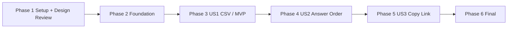

# Tasks: 活動結果 CSV 匯出與收件順位呈現

**Input**: `specs/003-export-answer-orders/`的spec.md、plan.md、research.md、data-model.md、contracts/interfaces.md、quickstart.md、review-notes.md及四張PlantUML。

**Prerequisites**: 規格／兩項釐清與設計產物齊備；維護者已於本次implement完成T002設計及AI設計文件核對，各Phase實作文件人審仍須分別完成。

**Tests**: spec Assumptions與憲章IV明確要求正常及特殊情境測試，納入TDD、正式隔離SQLite／HTTP／E2E及Excel人工驗收；不是把範本可選測試一律塞入。

**Organization**: 六個串行Phase：Setup、Foundational、US1(P1)、US2(P1)、US3(P2)、Final。初始清單全部未勾；現依實際完成結果追蹤，T007仍須本階段文件人工核對及合併。

## Format and Path Conventions

格式為`- [ ] Tnnn [P?] [USn?] 描述及檔案路徑`，路徑以repo根為準，文件內相對連結以本目錄為準。[P]僅表示同Phase、共享前置完成後不同檔案的可並行工作，不授權跨Phase或自行建立額外代理。

任務中單獨提及的plan.md、research.md、data-model.md、quickstart.md、review-notes.md、contracts/與diagrams/均明確指本功能目錄`specs/003-export-answer-orders/`內的設計文件，不指repo根目錄；產品與測試檔則使用列出的repo相對路徑。

所有約束的canonical來源是 [data-model.md欄位索引](data-model.md#field-citation-index) 及其原定義；implement任務逐欄明引Entity.field，不重複或放寬規則。索引對應既有snapshot的id，不增加wire格式或DB schema。

## Common Phase Gate and Branch Policy

每Phase從當時main建立下列唯一codex分支，不重用前Phase；保留既有使用者變更。前Phase完整測試、該階段文件人工核對及merge main後才能進下Phase。[P]不跨此門檻，也不表示多故事可同時實作。

每Phase結尾執行：

```powershell
npm run typecheck
npm run lint
npm run format:check
npm run test:unit
npm run test:integration
npm run test:contract
npm run test:e2e
npm run build
```

各指令須exit0並記實際數量／結果；另明確檢查003 Markdown、四圖checkonly／有效渲染及git diff --check。依憲章V，本Phase新增／修改的AI文件要由維護者以實作／設定／結果核對，不能等Final補前面人審。merge hash可合併後補記，再同步main，不新增產品行為。沒有人工結論不合併。

測試只用已驗證的臨時DB／埠與合成授權，不能讀正式憑證／DB、停止現有正式服務或修改真實Google教材。產品及報告不得保存Cookie／CSRF／OAuth原值。003沒有migration、背景export job或下載持久收據。

測試先寫並確認因缺少新能力而失敗，再實作；對已存在能力的回歸可能首次通過，誠實記錄，不造假RED。每個故事在自身Phase交付可獨立使用入口；US1包含目前與歷史CSV按鈕，不能拖到US2才可操作。

## Phase 1: Setup — 準備與設計門檻

**Branch**: `codex/003-phase-1-setup`

**Goal**: 建立隔離驗收基礎，核對設計後才允許寫產品程式。

**Independent Test / Checkpoint**: Node／依賴／原回歸可用；新fixture只能操作自身臨時DB及埠；四圖及本階段文件人審後合併。

- [x] T001 確認main狀態並建立本Phase新分支，保留既有變更；將branch／基線與本次003文件範圍記入 specs/003-export-answer-orders/review-notes.md。
- [x] T002 取得維護者對 specs/003-export-answer-orders/review-notes.md 設計包、plan.md、data-model.md、contracts/interfaces.md與diagrams/\*.puml的人工核對；依憲章I／V，未確認不進後續產品實作，不能沿用002人審。
- [x] T003 核對 package.json 的Node24基線及既有npm scripts，執行目前全套Gate並將實際數量／exit code記 specs/003-export-answer-orders/review-notes.md；168僅既有歷史數，不先填新結果，不新增依賴或修改憑證。
- [x] T004 [P] 在 .gitignore、.prettierignore 核對臨時DB／sidecars／validation-results內下載CSV與機密產物排除，git check-ignore只用無效示範路徑；保留migration原始碼與可提交的合成fixture，不全域忽略所有CSV。
- [x] T005 [P] 先在 tests/unit/result-export-fixture.test.ts 定義canonical三組兩題／交錯收件、未加入組及臨時路徑清理界線的fixture測試，記錄因helper尚缺而失敗，不讀正式DB。
- [x] T006 在 tests/helpers/result-export.ts 沿用catalog-server／temporary-database建立真實SQLite與合成Google的canonical及性能fixture，可保存多個ended歷史與一個active場；支援job狀態／故障注入且只清理驗證過的自身臨時目錄，使前項測試通過。
- [x] T007 同步 specs/003-export-answer-orders/quickstart.md、review-notes.md 的Phase 1結果，執行完整Gate及四圖驗證、取得本階段AI文件人工核對後commit／merge main並補記hash；缺門檻不合併。

## Phase 2: Foundational — 共用順位與唯讀基礎

**Branch**: `codex/003-phase-2-foundation`

**Goal**: 建立共用純順位、型別及不更動既有寫交易的同步唯讀快照。

**Independent Test / Checkpoint**: 同一teacher資料導出一致全場／逐題順序；空／缺漏／重複資料可辨，query_only與交易旗標於成功及失敗後恢復，學生DTO不變。

- [ ] T008 確認Phase 1已測試、人審及merge main，建立本Phase新分支，記 specs/003-export-answer-orders/review-notes.md。
- [ ] T009 [P] 先在 tests/unit/answer-order.test.ts 驗交錯sequence／同timestamp、single／完整題組、零受理／未加入組、重複group-question／sequence／缺item拒絕、1..N連續、完整名與輸入不突變，記錄新功能缺少的RED。
- [ ] T010 [P] 先在 tests/integration/export-read-snapshot.test.ts 驗真實臨時SQLite的readSnapshot一致讀取、寫入／巢狀／Promise／afterCommit拒絕、callback拋錯及query_only原值／讀寫旗標恢復，不讓測試變成正式DB操作。
- [ ] T011 [P] 先在 tests/unit/result-export-errors.test.ts 驗EXPORT_BUSY／EXPORT_TOO_LARGE的安全HTTP／retryable映射及無效合成值不進錯誤／logger，保留原錯誤契約。
- [ ] T012 [P] 先在 tests/contract/result-export-schema.test.ts 驗實際teacher snapshot可映成所需輸入、未加入空名及額外既有metadata的顯式pick，student缺submissions不當作零受理，無新student／Socket欄位。
- [ ] T013 在 shared/src/schemas/result-export.ts 定義並顯式pick純順位輸入、重用既有名稱／答案規則；依 [data-model.md](data-model.md#field-citation-index) `AnswerOrderInput.questions`、`AnswerOrderInput.questions[].id`、`AnswerOrderInput.questions[].displayNumber`、`AnswerOrderInput.questions[].kind`、`AnswerOrderInput.questions[].items`、`AnswerOrderInput.questions[].items[].id`、`AnswerOrderInput.questions[].items[].label`、`AnswerOrderInput.questions[].items[].prompt`、`AnswerOrderInput.groups`、`AnswerOrderInput.groups[].id`、`AnswerOrderInput.groups[].ordinal`、`AnswerOrderInput.groups[].name`、`AnswerOrderInput.groups[].occupied`、`AnswerOrderInput.submissions`、`AnswerOrderInput.submissions[].id`、`AnswerOrderInput.submissions[].groupId`、`AnswerOrderInput.submissions[].questionId`、`AnswerOrderInput.submissions[].sequence`、`AnswerOrderInput.submissions[].answers` 的canonical定義，不得把既有id誤改為新的wire欄位。
- [ ] T014 在 shared/src/projections/answer-order.ts 實作唯一純deriveAnswerOrder及型別化失敗、重用group-name formatter；依 [data-model.md](data-model.md#field-citation-index) `OrderedAnswer.submissionId`、`OrderedAnswer.questionId`、`OrderedAnswer.groupId`、`OrderedAnswer.fullGroupName`、`OrderedAnswer.globalSequence`、`OrderedAnswer.questionRank`、`OrderedAnswer.items`、`OrderedAnswer.items[].itemId`、`OrderedAnswer.items[].label`、`OrderedAnswer.items[].prompt`、`OrderedAnswer.items[].answer`、`QuestionOrder.questionId`、`QuestionOrder.displayNumber`、`QuestionOrder.kind`、`QuestionOrder.items`、`QuestionOrder.entries`、`QuestionOrder.unansweredGroups`、`QuestionOrder.unansweredGroups[].groupId`、`QuestionOrder.unansweredGroups[].ordinal`、`QuestionOrder.unansweredGroups[].fullGroupName`、`AnswerOrderView.all`、`AnswerOrderView.questions` 的canonical定義；型別若需由result-export.ts匯出同步處理，無新持久排名。
- [ ] T015 在 backend/src/persistence/connection.ts 實作data-model.md ExportSnapshot章的同步readSnapshot：保存並暫設query_only、BEGIN DEFERRED、COMMIT／ROLLBACK與finally恢復，與既有寫交易互斥；不await、不改寫原BEGIN IMMEDIATE語意，使對應測試通過。
- [ ] T016 在 shared/src/schemas/common.ts、backend/src/security/safe-errors.ts 加入契約兩種匯出安全錯誤碼與allowlist映射，沿用logger事件白名單；不得把payload／headers／內部例外帶出。
- [ ] T017 將基礎驗證及測試結果同步 specs/003-export-answer-orders/review-notes.md、quickstart.md，完整Gate與四圖通過且維護者核對本階段AI文件後commit／merge main，記實際hash。

## Phase 3: User Story 1 — 單場已結束活動CSV下載 (P1 / MVP)

**Branch**: `codex/003-phase-3-csv-export`

**Goal**: 所屬老師從目前／單一歷史活動取得完整、安全且格式一致的CSV，不需要其他新功能即可使用。

**Independent Test / Checkpoint**: canonical fixture的3資料列／9欄及交錯兩題順位正確；未加入組未作答、完整UUID／Taipei檔名、Excel文字與特殊字元可用；非owner／未ended／錯誤無下載，原DB與Google工作不變。

- [ ] T018 [US1] 確認Phase 2已merge main後建立本Phase新分支，在 specs/003-export-answer-orders/review-notes.md 記錄前置與分支。
- [ ] T019 [P] [US1] 先在 tests/unit/csv-export.test.ts 驗一次BOM、全欄quoting／CRLF、逗號／引號／多行／emoji、單題空子題、題組共rank、獨立Amax／Umax、零受理、excel-tab-v1及各尺寸邊界；隔離較早限制以實際測到指定邊界。
- [ ] T020 [P] [US1] 先在 tests/unit/export-filename.test.ts 驗建場快照名、雲端改名不影響、空／禁字／CRLF／長emoji、240雙預算不破code point、完整UUID、Taipei跨日及RFC8187單引號／括號編碼。
- [ ] T021 [P] [US1] 先在 tests/unit/export-gate.test.ts 用控制時鐘驗research R4頻率、單生成、busy不排隊、拿slot才計次、期限／取消／失敗釋放、過期清理及Retry-After，不依賴真實等待。
- [ ] T022 [P] [US1] 先在 tests/integration/result-export.test.ts 定義真實隔離DB的owner current／history ended下載、各回填狀態／Google不可用、重複匯出與全部rows／slot／revision／job不變，以及重啟後原帳號可取得同場。
- [ ] T023 [P] [US1] 先在 tests/contract/result-export-http.test.ts 驗GET binary與HEAD405、teacher／student／no session／no OAuth／B、CSRF／Host／Origin／UUID／非空query-body、phase、429／422／503錯誤JSON且無attachment、送出前authGeneration變更。
- [ ] T024 [P] [US1] 先在 tests/e2e/result-export.spec.ts 定義目前／單一歷史下載與檔名／BOM、按鈕不可用原因、JSON／HTML／wrong MIME／body失敗不下載、scope取消、objectURL清理、僅開始下載不誤稱存磁碟。
- [ ] T025 [P] [US1] 在 tests/integration/export-read-snapshot.test.ts 加入export reader缺源／fingerprint／正規化題目／答案／frozen結果拒絕；尤其先刪非winner答案再刪submission但保留counter／winner，必須拒絕，不得補為未作答。
- [ ] T026 [US1] 在 backend/src/export/limits.ts 集中research.md R4的Excel與本機唯一數值常數及有界尺寸檢查；不散落複製常數、不透過截答案／省組／拆檔通過上限。
- [ ] T027 [US1] 在 backend/src/persistence/result-export-reader.ts 完成owner限定metadata／ended／raw bytes先預檢及來源fingerprint／正規化題目對照；依 [data-model.md](data-model.md#field-citation-index) `activities.id`、`activities.owner_account_id`、`activities.phase`、`activities.revision`、`activities.group_count`、`activities.next_sequence`、`activities.spreadsheet_title`、`activities.source_snapshot_json`、`activities.source_fingerprint`、`questions.activity_id`、`questions.question_id`、`questions.display_number`、`questions.kind`、`questions.ordinal`、`question_items.activity_id`、`question_items.question_id`、`question_items.item_id`、`question_items.ordinal`、`question_items.label`、`question_items.prompt` 的canonical定義，先限制再解析快照，不重讀Google。
- [ ] T028 [US1] 在 backend/src/persistence/result-export-reader.ts 的同一readSnapshot收集全部組別、受理、子題答案及固定結果並嚴格驗集合／計數；依 [data-model.md](data-model.md#field-citation-index) `activity_groups.activity_id`、`activity_groups.id`、`activity_groups.ordinal`、`activity_groups.participant_id`、`activity_groups.name`、`submissions.activity_id`、`submissions.id`、`submissions.group_id`、`submissions.question_id`、`submissions.request_id`、`submissions.received_at`、`submissions.sequence`、`submission_answers.activity_id`、`submission_answers.submission_id`、`submission_answers.question_id`、`submission_answers.item_id`、`submission_answers.answer`、`results.activity_id`、`results.question_id`、`results.winner_submission_id` 的canonical定義，不讀participant digest或job作匯出前提。
- [ ] T029 [US1] 在 backend/src/persistence/result-export-reader.ts、backend/src/activity/result-export-service.ts 組合一致導出資料與記憶體核權scope；依 [data-model.md](data-model.md#field-citation-index) `ExportSnapshot.activityId`、`ExportSnapshot.activityName`、`ExportSnapshot.phase`、`ExportSnapshot.revision`、`ExportSnapshot.groupCount`、`ExportSnapshot.order`、`ExportSnapshot.exportedAt`、`ExportSnapshot.nextSequence`、`ExportRequestScope.ownerAccountId`、`ExportRequestScope.session`、`ExportRequestScope.authGeneration` 的canonical定義，含nextSequence／frozen winner完整性，不installActivity、建receipt或wake worker。
- [ ] T030 [US1] 在 backend/src/export/csv.ts 實作固定layout、有界逐格安全文字／quoting／BOM生成；依 [data-model.md](data-model.md#field-citation-index) `CsvLayout.dataRowCount`、`CsvLayout.aMax`、`CsvLayout.uMax`、`CsvLayout.columnCount`、`CsvLayout.headers`、`CsvLayout.cellText`、`CsvLayout.row` 的canonical定義及 [data-model.md](data-model.md#field-citation-index) `DownloadArtifact.bytes`、`DownloadArtifact.contentType`，在prefix／轉義後檢查，不先送半份body。
- [ ] T031 [US1] 在 backend/src/export/filename.ts 實作來源快照名、Taipei時間、雙預算basename與ASCII／filename\*；依 [data-model.md](data-model.md#field-citation-index) `DownloadArtifact.filename`，保留完整UUID及副檔名，不使用payload作header。
- [ ] T032 [US1] 在 backend/src/export/export-gate.ts 實作research R4及contracts的獨立session頻率／全域slot／協作deadline／中斷清理，不共用mutation budget、不保存下載job或認證值。
- [ ] T033 [US1] 在 backend/src/activity/result-export-service.ts 接上reader、純順位、limits、gate、codec及filename，按契約chunk讓出事件迴圈並重驗原owner／generation／取消；完成前不回bytes，失敗finally釋放所有暫存。
- [ ] T034 [US1] 在 backend/src/http/result-export-routes.ts、backend/src/source-module.ts 只註冊teacher GET與先於GET的HEAD405，接入既有Host／Origin／session及GET明確CSRF、空輸入／owner／phase，完整驗證後200 CSV或安全JSON，不產ETag／304。
- [ ] T035 [US1] 在 frontend/src/transport/download.ts 實作專用binary fetch、CSRF／AbortSignal、JSON錯誤與MIME／attachment解析、blob保BOM、objectURL生命週期及觸發前scope檢查；依 [data-model.md](data-model.md#field-citation-index) `OperationScope.activityId`、`OperationScope.bootId`、`OperationScope.sessionVersion`、`OperationScope.authGeneration`、`OperationScope.epoch` 的canonical定義，不重用固定JSON的http()解碼CSV。
- [ ] T036 [US1] 在 frontend/src/teacher/ExportResultsButton.tsx 實作單場狀態、ended限制、loading停用與固定安全文字提示；依 [data-model.md](data-model.md#field-citation-index) `Download.state`，錯誤不誤報下載或存磁碟成功。
- [ ] T037 [US1] 在 frontend/src/teacher/ActivityPage.tsx、frontend/src/teacher/HistoryDetailPage.tsx 接入各自活動的ExportResultsButton與完整scope，回填pending／conflict／failed不阻下載，不提供全活動批次操作；保留原畫面與回填控制。
- [ ] T038 [US1] 在 frontend/src/App.tsx、frontend/src/components/Classroom.tsx 傳遞及隔離非機密teacher scope；變更teacher key或等效取消機制以涵蓋boot／sessionVersion／authGeneration，學生key與原匿名恢復不擴改，不將CSRF或Cookie放key。
- [ ] T039 [US1] 在 tests/integration/result-export-secret-exposure.test.ts 以無效合成值驗CSV／header／filename／JSON error／logger／報告無OAuth、CSRF、Cookie或digest，且Google calls與receipt／job新增0；只讀取測試自身臨時資料。
- [ ] T040 [US1] 在 tests/manual/export-results-fixture.mjs 建立quickstart規劃的合成檔案助手，真正經隔離teacher下載端點產一般／安全文字檔，只輸出允許的validation-results子路徑，不輸出授權headers或原值、不覆蓋正式DB。
- [ ] T041 [US1] 依 specs/003-export-answer-orders/quickstart.md 的Excel章，以前項合成檔實際開啟，記版本／build／地區、中文／欄位／多行／安全文字及檔名結論於review-notes.md；沒有Excel或未人工確認時保持本項未勾，不能以parser或來源文件冒充。
- [ ] T042 [US1] 在 tests/integration/result-export-performance.test.ts 先驗指定規模下載時間與取消／busy資源釋放，記實際結果至 specs/003-export-answer-orders/review-notes.md，不透過截斷內容或跳過大小檢查達標。
- [ ] T043 [US1] 執行全部Gate、四圖及MVP獨立驗收，核對現有Google直接讀寫／學生隱私／歷史回歸；更新 specs/003-export-answer-orders/quickstart.md、review-notes.md，取得本階段文件與Excel結果人工核對。
- [ ] T044 [US1] 僅前述技術與人工門檻全通過後commit／merge main，將實作及合併hash補入 specs/003-export-answer-orders/review-notes.md；不push、部署或為測試修改真實教材。

## Phase 4: User Story 2 — 全場與逐題順位介面 (P1)

**Branch**: `codex/003-phase-4-answer-order`

**Goal**: 老師在目前活動與歷史詳情看懂全場序號、本題順位及完整子題答案，與CSV一致。

**Independent Test / Checkpoint**: 交錯四筆結果可直接辨識全場1–4與兩題各1–2；active history及目前頁兩視角2秒內更新，40字／長文與鍵盤可讀，ended與CSV一致且學生無新增資料。

- [ ] T045 [US2] 確認US1已測試／人審並merge main後建立本Phase新分支，記 specs/003-export-answer-orders/review-notes.md。
- [ ] T046 [P] [US2] 先在 tests/e2e/answer-order.spec.ts 定義全部／逐題兩視角、題目select、交錯排名／完整題組／未加入組／空狀態、40字／特殊字／長文／鍵盤與同場CSV排序一致的RED案例。
- [ ] T047 [P] [US2] 先在 tests/e2e/answer-order-history.spec.ts 定義waiting／active原場歷史live、ended一次刷新、非current一次重讀不循環、切帳號／boot晚回覆與2秒更新案例，使用隔離真實活動流程。
- [ ] T048 [US2] 在 frontend/src/teacher/AnswerOrderPanel.tsx 實作兩個aria-pressed一般button、帶label題目select、全部／逐題內容與錯誤／空狀態；依 [data-model.md](data-model.md#field-citation-index) `AnswerOrderPanel.view`、`AnswerOrderPanel.selectedQuestionId`，使用已驗證的AnswerOrderView，不另算排名。
- [ ] T049 [US2] 在 frontend/src/teacher/HistoryLiveAnswers.tsx 實作既有useActivity原場訂閱、ended／非current一次detail刷新及取消護欄；依 [data-model.md](data-model.md#field-citation-index) `HistoryLive.state`，不輪詢、不重建活動、不將舊scope資料顯為新帳號。
- [ ] T050 [US2] 在 frontend/src/teacher/ActivityPage.tsx、frontend/src/teacher/HistoryDetailPage.tsx 整合共用Panel與live wrapper，取代舊div／按組散列答案，保留ProgressTable／ResultsView／writeback與US1下載；資料錯誤只顯該區錯誤，不使整頁render失敗。
- [ ] T051 [US2] 在 frontend/src/styles.css 完成題號、全場序號、本題順位、完整組名與子題答案的可讀排版、長文換行及可聚焦橫捲；所有差異有文字、鍵盤焦點可見，不加自動讀出全部答案的廣播。
- [ ] T052 [US2] 重跑並必要時僅調整 tests/contract/student-projections.test.ts、tests/e2e/anonymous-join-privacy.spec.ts 的畫面定位，保留全部權限／隱題／受理／完整名／2秒斷言，新增教師UI不得擴student projection或改成功組。
- [ ] T053 [US2] 執行完整Gate與四圖，將目前／歷史／CSV一致性、鍵盤及可讀性證據與實際測試數記 specs/003-export-answer-orders/review-notes.md，更新quickstart.md的已實作範圍。
- [ ] T054 [US2] 請維護者核對本階段可見UI／鍵盤及 specs/003-export-answer-orders/review-notes.md、quickstart.md 與實作／結果一致；未回覆不填通過，US1核對不替代本項。
- [ ] T055 [US2] 本Phase全門檻通過後commit／merge main，於 specs/003-export-answer-orders/review-notes.md 記合併hash及限制，不提前開始US3。

## Phase 5: User Story 3 — 複製活動連結 (P2)

**Branch**: `codex/003-phase-5-copy-link`

**Goal**: 老師以一次啟用複製畫面同一完整學生URL，成功與失敗回饋誠實且有手動備援。

**Independent Test / Checkpoint**: click／Enter／Space得到正確host／port／完整UUID；resolve才成功、reject／無能力可手動複製，切活動／帳號後舊promise不回饋，產品不讀clipboard。

- [ ] T056 [US3] 確認US2已merge main後建立本Phase新分支，記 specs/003-export-answer-orders/review-notes.md。
- [ ] T057 [P] [US3] 先在 tests/e2e/copy-activity-link.spec.ts 定義精確顯示URL、click／Enter／Space、resolve／reject／無能力、pending停用與手動可選網址，驗已知結果後1秒回饋及產品只write不read。
- [ ] T058 [P] [US3] 先在 tests/e2e/copy-link-scope.spec.ts 定義URL／帳號／boot／卸載與延遲promise、連點／無連結案例，舊結果不得套新scope或再次寫舊URL，不宣稱撤回已送瀏覽器的寫入。
- [ ] T059 [US3] 在 frontend/src/components/CopyActivityLinkButton.tsx 實作立即writeText、能力判斷、pending／resolve／reject及epoch防護；依 [data-model.md](data-model.md#field-citation-index) `Copy.state`、`Copy.studentUrl` 及OperationScope原定義，保持原字串、無網路等待與clipboard讀取。
- [ ] T060 [US3] 在 frontend/src/teacher/ActivityPage.tsx 將anchor與複製按鈕共用同一完整studentUrl，傳當場非機密scope，無有效連結停用並明示原因；不新增分享API、權杖、QR或代發訊息。
- [ ] T061 [US3] 在 frontend/src/styles.css 完成長URL換行／可選取、按鈕與role=status／alert提示的鍵盤焦點及可讀性，避免僅用顏色回饋，不影響兩種答案視角。
- [ ] T062 [US3] 執行全Gate與四圖，記正確複製／備援／晚promise及原下載／順位回歸於 specs/003-export-answer-orders/review-notes.md，更新quickstart.md，不以使用者真實剪貼簿作自動化fixture。
- [ ] T063 [US3] 取得維護者對 specs/003-export-answer-orders/review-notes.md、quickstart.md 本階段介面與結果的人工核對，未確認不記通過。
- [ ] T064 [US3] 本Phase驗證與人審完成後commit／merge main，於 specs/003-export-answer-orders/review-notes.md 補hash，不push或部署。

## Phase 6: Polish and Cross-Cutting — 最終驗收

**Branch**: `codex/003-phase-6-final`

**Goal**: 驗證三功能連續流程、容量及效能／隱私，核對全部任務、文件與人工證據。

**Independent Test / Checkpoint**: 全新功能與未被取代既有回歸、四圖及文件檢查全過，真實Excel有結論，零新增業務寫入或洩密，所有門檻與最終人工核對後合併。

- [ ] T065 確認US3已merge main後建立本Phase新分支，於 specs/003-export-answer-orders/review-notes.md 記錄前置。
- [ ] T066 [P] 在 tests/e2e/result-export-workflow.spec.ts 補連續流程：分組完整作答→結束→目前／歷史單場下載→兩視角比對→複製→重開歷史，於既有worker穩定後比對新操作不改DB／順位／job，保留Google直接流程；既有行為可首次通過，不製造假RED。
- [ ] T067 [P] 在 tests/integration/result-export-performance.test.ts 補有界匯出與另一active活動同時收件／即時教師更新、不同session資源隔離、取消後可再生成的指定規模驗收；以真實臨時HTTP／SQLite量測，不只測純函數或mock時間。
- [ ] T068 執行 package.json 全部Gate、四圖checkonly／重新渲染、明確003 Markdown格式與連結檢查，重跑新增及所有未取代舊案例，於 specs/003-export-answer-orders/review-notes.md 記實際數量／exit code，不能只沿用前Phase結果。
- [ ] T069 核對 specs/003-export-answer-orders/review-notes.md 的US1 Excel版本／build／地區及安全文字實測證據；CSV／文字政策未變可引用該次有效結果，若後續變更影響輸出則按quickstart重做受影響人工驗收，未完成保持待辦。
- [ ] T070 在 specs/003-export-answer-orders/tasks.md、review-notes.md 逐項核對FR／SC、data-model欄位引用、已受理整筆遺失／未加入組／帳號隔離／特殊字元／容量／限流／deadline／晚回覆等證據；未完成保持未勾，不以任務數充當功能證據。
- [ ] T071 依實際程式與結果同步 specs/003-export-answer-orders/quickstart.md、contracts/interfaces.md、plan.md、review-notes.md，排除範本與錯誤欄位／連結；若流程改變先同步diagrams/\*.puml並重新人工設計審查，再修實作。
- [ ] T072 在 specs/003-export-answer-orders/review-notes.md 組成最終審查包，列支援版本、剩餘限制、實際效能／Excel／完整測試與無機密產物證據，明確無新DB表或Google副作用。
- [ ] T073 取得維護者對 specs/003-export-answer-orders/review-notes.md 最終AI文件與實測一致性的人工核對；不以先前Phase人審或「繼續」代替實際確認。
- [ ] T074 所有門檻完成後commit／merge main，於 specs/003-export-answer-orders/review-notes.md 記最終實作／合併hash與限制，核對tasks全數完成、工作樹狀態；不自動push、部署或另改Google教材。

## Dependencies and Execution Order



技術上US1／US2共用Phase 2純順位，US3不依賴CSV內容；這不改使用者要求的實際串行順序。故事之間無業務資料循環依賴，新增介面各可獨立驗收。每個Phase首項branch／前置、末項人審後merge為執行邊界。

### Within Each Story

先寫本Phase列出的測試，再完成模型／服務／傳輸及UI，最後獨立故事驗收、全Gate及AI文件人工核對。相同檔案後續任務串行，例如reader三項與ActivityPage後續整合不能並行。所有[P]測試撰寫不依賴尚未實作的能力通過，可先記錄相同前置不足而RED，但不能把未跑測試說成失敗證據。

## Parallel Execution Examples

### US1

前一Phase已merge且本Phasebranch已建立後，以下不同檔案的測試可並行撰寫；產品實作仍按本故事任務次序，整個Phase Gate通過才往後：

- T019：tests/unit/csv-export.test.ts
- T020：tests/unit/export-filename.test.ts
- T021：tests/unit/export-gate.test.ts
- T022：tests/integration/result-export.test.ts
- T023：tests/contract/result-export-http.test.ts
- T024：tests/e2e/result-export.spec.ts
- T025：tests/integration/export-read-snapshot.test.ts

### US2

前一Phase已merge且本Phasebranch已建立後，以下不同檔案的測試可並行撰寫；產品實作仍按本故事任務次序，整個Phase Gate通過才往後：

- T046：tests/e2e/answer-order.spec.ts
- T047：tests/e2e/answer-order-history.spec.ts

### US3

前一Phase已merge且本Phasebranch已建立後，以下不同檔案的測試可並行撰寫；產品實作仍按本故事任務次序，整個Phase Gate通過才往後：

- T057：tests/e2e/copy-activity-link.spec.ts
- T058：tests/e2e/copy-link-scope.spec.ts

## Implementation Strategy

### MVP First

先完成Phase 1設計／隔離與Phase 2共用基礎，再完成Phase 3 US1：所屬老師已結束的單場CSV，目前與歷史皆有入口，含權限／錯誤／安全文字／容量／真實Excel驗收。US1可單獨使用，不必先有新順位Panel或複製按鈕。不要自動部署；示範只用合成資料。

### Incremental Delivery

US1通過及merge後加入US2的雙視角／live history，再加入US3複製；每一步保留既有角色、學生隱私、完整題組、受理序號、持久化及自動回填回歸。Final核對連續使用、效能、所有需求／欄位與人審證據，不把先前168項或任務打勾當成003實測。

## Requirement Coverage

| 需求／成果                            | 主要Phase及驗收                                                                        |
| ------------------------------------- | -------------------------------------------------------------------------------------- |
| FR-001–FR-017、SC-001–SC-005、SC-009  | Phase 2共用資料完整性＋Phase 3 US1 binary／CSV／名稱／權限／容量／Excel，Final重核     |
| FR-018–FR-021、SC-006–SC-007          | Phase 2唯一順位＋Phase 4 US2目前與live history、鍵盤／可讀性、CSV一致                  |
| FR-022–FR-023、SC-008                 | Phase 5 US3剪貼簿正常／失敗／手動備援／鍵盤                                            |
| FR-024–FR-026、SC-003、SC-007、SC-010 | 每Phase與Final的scope、學生／owner隔離、合成敏感值、無業務寫入／Google副作用及既有回歸 |

## Notes

設計／AI文件／Excel人工門檻須真實完成，不用自動檢查或「繼續」冒充確認。測試失敗先修正再重跑；設計流程變動先更新PlantUML並審查。此tasks文件僅產生工作清單，不代表已建立分支、提交、合併、部署或通過任一產品驗收。
